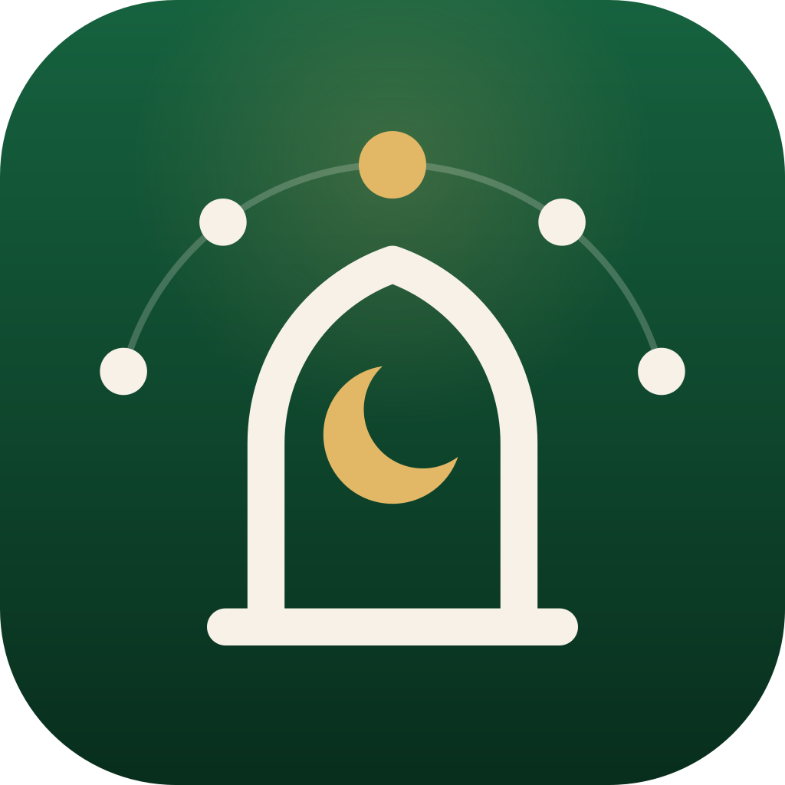

# Solatify

<p align="center">
  
</p>
<p align="center">
  <b>Pendamping Ibadah Harian Muslim yang modern, presisi, ringan, dan responsif.</b>
</p>
<p align="center">
  <a href="https://solatify.my.id">solatify.my.id</a> ·
  <a href="https://github.com/imransetiadi/solatify/releases/tag/v1.0.0-rc4">Unduh APK Android (v1.0.0-rc4)</a>
</p>

---

**Solatify** adalah aplikasi Flutter untuk membantu aktivitas ibadah harian: jadwal salat, alarm adzan, Al-Qur'an dengan murotal, tuntunan salat, kiblat, masjid terdekat, konten islami, tracker ibadah, widget layar utama, dan pengaturan personal. Aplikasi dibangun dengan pola **Clean Architecture feature-first**, state management Riverpod, penyimpanan lokal Hive, dan fokus pada pengalaman yang stabil di Android maupun iOS.

## 📥 Unduh

| Platform | Status |
|---|---|
| Android | APK release candidate `v1.0.0-rc4` tersedia di [GitHub Releases](https://github.com/imransetiadi/solatify/releases/tag/v1.0.0-rc4) |
| iOS | Segera hadir |

> **Catatan rc4:** APK ini ditandatangani dengan debug key yang sama dengan rc3, jadi bisa dipasang langsung di atas rc3 tanpa uninstall dan data tetap aman. APK ini bisa dipasang langsung (sideload) untuk uji coba, tetapi belum bisa diunggah ke Play Console. Build yang nanti memakai keystore rilis tidak bisa dipasang di atas versi ini tanpa uninstall terlebih dahulu. Lihat [docs/DEPLOYMENT.md](docs/DEPLOYMENT.md) untuk menyiapkan signing rilis.

## ✨ Fitur Utama

- 🕋 **Jadwal Salat Akurat**: Kalkulasi waktu salat berbasis `adhan` dan `timezone` dengan zona WIB/WITA/WIT mengikuti provinsi (Surabaya dan seluruh Jawa Timur tetap WIB), zona yang benar untuk kota di luar negeri, enam metode kalkulasi (Kemenag, Muslim World League, ISNA, Mesir, Umm al-Qura, MUIS Singapura), serta koreksi manual per waktu salat. Jadwal dihitung ulang otomatis saat hari berganti di lokasi salat dan saat aplikasi dibuka kembali.
- 🔔 **Alarm Adzan Otomatis**: Notifikasi lokal waktu salat yang berjalan offline dan dijadwalkan **enam hari ke depan**, sehingga tetap berbunyi walau aplikasi tidak dibuka beberapa hari. Tersedia toggle per waktu salat, pengingat sebelum salat, mode suara adzan/beep/silent, dan riwayat status penjadwalan. Di Android, adzan diputar sekali dengan tombol **Hentikan adzan** di notifikasi.
- 📖 **Al-Qur'an & Murotal**: Daftar surah, reading mode dengan kontrol ukuran font Arab, toggle transliterasi/terjemahan, progres surah, bookmark, dan terakhir dibaca. Murotal Mishary Rashid Alafasy bisa diputar per ayat atau satu surah penuh, **tetap berjalan di latar belakang** dengan mini-player di atas navigasi bawah serta kontrol di layar kunci dan notifikasi.
- 🤲 **Dzikir, Doa & Tuntunan Salat**: Dzikir pagi dan petang dengan teks lengkap (Ayat Kursi dan tiga surah Qul diambil dari sumber yang sama dengan pembaca Qur'an), doa harian, Asmaul Husna, tips islami, dan urutan salat dengan bacaan Arab, latin, dan arti.
- 🧭 **Arah Kiblat**: Kompas berbasis sensor perangkat lewat kanal native Solatify sendiri, mengacu ke utara sejati (deklinasi magnet dikoreksi di Android), dengan petunjuk kalibrasi dan tampilan simulasi saat sensor tidak tersedia. Sensor hanya aktif selama layar kiblat dibuka.
- 🕌 **Masjid Terdekat**: Masjid dalam radius 5 km dari data OpenStreetMap lewat layanan pencarian [Photon](https://photon.komoot.io), biasanya tampil dalam sekitar 1 detik, lengkap dengan alamat, tombol lihat peta, dan rute lewat aplikasi peta. Server Overpass dipakai sebagai cadangan bila Photon tidak merespons, dan hasil pencarian terakhir disimpan sehingga tetap tampil saat server peta sedang sibuk.
- 🌙 **Kalender Hijriah**: Hari besar Islam dihitung dari kalender Umm al-Qura untuk tahun Hijriah berjalan dan berikutnya (tanggal resmi pemerintah bisa berbeda 1 hari).
- 📈 **Tracker Ibadah**: Checklist ibadah harian, heatmap 14 hari, streak, dan statistik mingguan.
- 📱 **Widget Layar Utama**: Widget iOS dan Android yang menampilkan salat berikutnya dengan hitung mundur live dan berpindah sendiri ke salat selanjutnya.
- 🎨 **Tema Responsif**: Light/dark mode, layout adaptif phone/tablet, dan komponen visual yang ringan saat scroll dan navigasi.

## 🛠 Arsitektur & Teknologi

- **Flutter + Dart** untuk aplikasi lintas platform Android dan iOS.
- **Riverpod** untuk state management yang eksplisit dan testable.
- **Photon** (OpenStreetMap) untuk pencarian masjid terdekat, dengan Overpass sebagai cadangan.
- **Hive** untuk cache lokal jadwal, pengaturan, tracker, data Al-Qur'an, dan hasil pencarian masjid. Box data pengguna dicadangkan, bukan dihapus, bila gagal dibuka.
- **GoRouter** untuk navigasi deklaratif, dengan konstanta rute di `AppRoutes`.
- **Clean Architecture** per fitur: `data`, `domain`, dan `presentation`.
- **Notification domain planner** memisahkan perencanaan jadwal adzan/reminder dari provider UI agar flow notifikasi lebih testable.
- **flutter_local_notifications** dan alarm native Android untuk notifikasi salat dan adzan.
- **just_audio + just_audio_background** untuk murotal di latar belakang dengan kontrol media sistem.
- **hijri** untuk konversi tanggal Hijriah (Umm al-Qura).
- **Kanal native** (`solatify/compass`, widget, pengaturan) di `AppDelegate` dan `MainActivity` untuk kompas, widget layar utama, dan izin.

## ⚡ Performa & Responsiveness

- Konfigurasi performa terpusat di `lib/core/performance/performance_tuning.dart`.
- Budget cold start, warm resume, frame build/raster, dan aset dijaga lewat test agar baseline tidak drift diam-diam.
- Countdown waktu salat memakai tick 1 detik tanpa inisialisasi database zona waktu per detik, dan hanya berjalan saat layar Beranda tampil.
- Widget layar utama menerima jadwal sekali saat berubah, bukan teks hitung mundur setiap detik; hitung mundurnya dijalankan oleh sistem.
- Cache detail surah dibuka saat pertama dibutuhkan, bukan saat startup.
- Scheduler notifikasi memakai sync plan sehingga hanya membatalkan/menjadwalkan ulang alarm yang berubah; sync penuh saat start, resume, dan perubahan pengaturan.
- List panjang memakai builder/lazy rendering pada fitur konten utama.
- Empty, loading, error, dan permission states memakai pola visual `SolatifyStateView`.
- Layar konten/detail memakai `SolatifyScreenScaffold` untuk AppBar, background islami, responsive center, dan padding yang konsisten.

## 🔔 Catatan Notifikasi

Notifikasi salat mendukung kontrol granular di Settings:

- Toggle per waktu salat untuk mengaktifkan hanya Subuh, Magrib, atau kombinasi lain. Waktu salat yang dimatikan langsung dibatalkan dari jadwal sistem.
- Pengingat sebelum salat, termasuk opsi 10 menit sebelum waktu salat.
- Mode suara `adhan`, `beep`, atau `silent notification`.
- Verifikasi izin setelah kembali dari Settings dan reschedule otomatis saat izin berubah.
- Notification Health Center di Settings untuk cek izin, pending schedule, riwayat terakhir, kirim test notifikasi, dan reschedule manual.

Untuk Android, notifikasi salat memakai channel `Prayer Times Adhan` (`prayer_times_adhan_channel`), `Prayer Times Beep` (`prayer_times_beep_channel`), dan `Prayer Times Silent` (`prayer_times_silent_channel`) dengan alarm native:

1. Install build terbaru dan buka aplikasi minimal sekali.
2. Berikan izin notifikasi (`POST_NOTIFICATIONS`) pada Android 13+.
3. Aktifkan izin exact alarm jika Android menampilkan pengaturan tersebut.
4. Pastikan channel notifikasi yang dipilih aktif di system notification settings.
5. Tunggu waktu salat berikutnya untuk memverifikasi notifikasi real prayer-time.

## ✅ QA & Kesiapan Build

Status `main` untuk rilis `v1.0.0-rc4`:

- `flutter analyze`: no issues.
- `flutter test`: 249 tests passed.
- `flutter build apk --release` dan `flutter build appbundle --release` berhasil.
- `flutter build ios --release` berhasil dan dipasang di iPhone 16 Pro (iOS 27.2).
- Pencarian masjid diuji langsung ke server: Jakarta 90 masjid dalam 0,88 detik, Denpasar 18 dalam 0,96 detik, Kuala Lumpur 31 dalam 1,05 detik.
- Audit lengkap Android dan iOS (8 November 2026) ada di [`docs/qa/full-app-audit-2026-11-08.md`](docs/qa/full-app-audit-2026-11-08.md).

Belum diverifikasi di perangkat: adzan tepat pada waktu salat dan widget yang berpindah antar salat. Dokumen QA tambahan tersedia di `docs/qa/`, dan catatan pengembangan di `docs/DEVELOPMENT_NOTES.md`.

## 💻 Memulai

1. **Clone repository**
   ```bash
   git clone https://github.com/imransetiadi/solatify.git
   cd solatify
   ```

2. **Install dependensi**
   ```bash
   flutter pub get
   ```

3. **Jalankan aplikasi**
   ```bash
   flutter run
   ```

## 🧪 Testing & Build

```bash
flutter test --no-pub          # unit dan widget test
flutter analyze --no-pub       # static analysis
flutter build apk --release    # APK Android
flutter build appbundle --release
flutter build ios --release    # butuh signing Apple Developer
```

Build release Android memakai `android/key.properties` bila tersedia; tanpa file itu Gradle memakai debug key dan menampilkan peringatan. Panduan lengkap ada di [docs/DEPLOYMENT.md](docs/DEPLOYMENT.md).

## 🌐 Website

Landing page ada di folder [`solatify-website/`](solatify-website/) (Next.js) dan tayang di [solatify.my.id](https://solatify.my.id). Setiap push ke `main` otomatis di-deploy oleh Vercel.

## 📜 Lisensi

MIT
